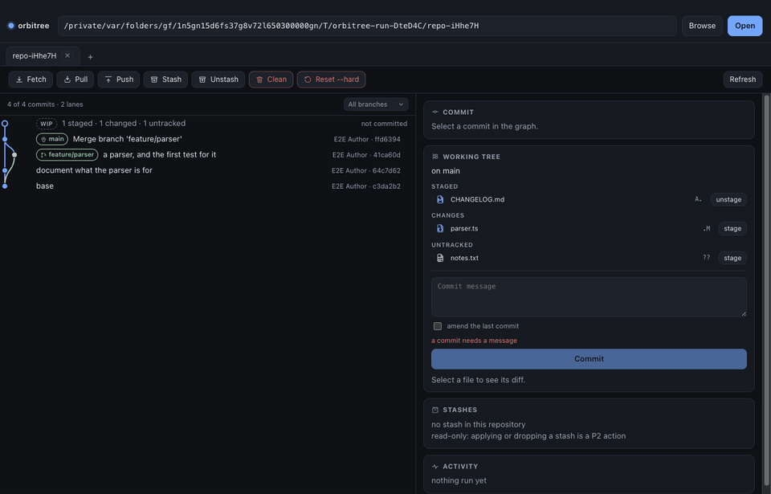
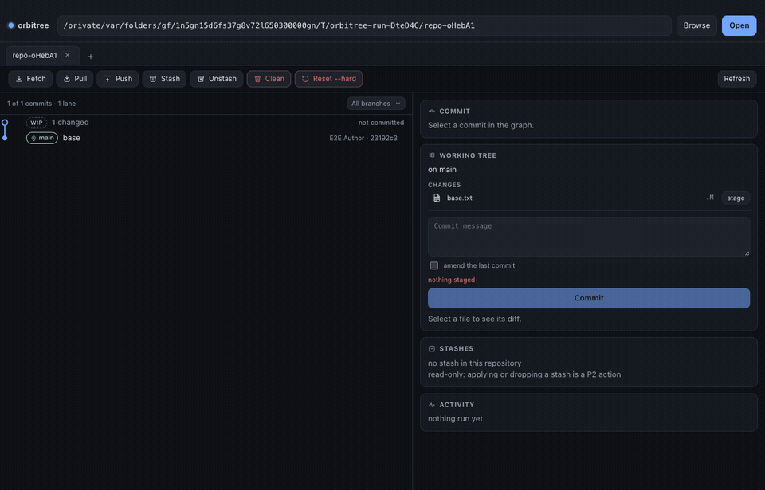
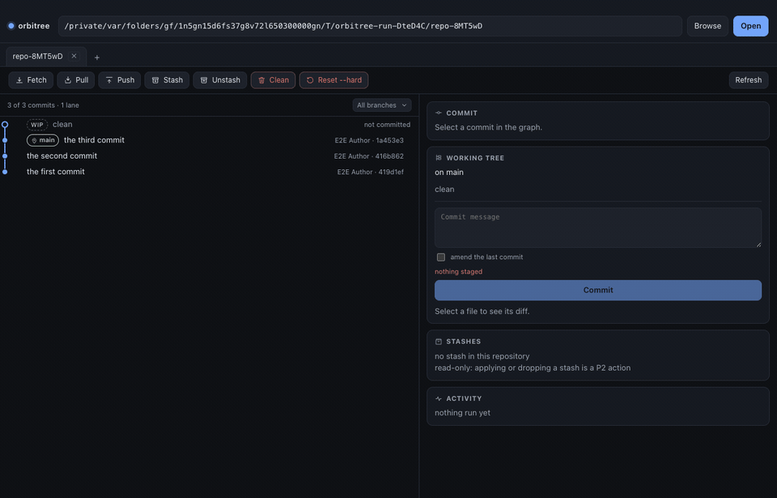

# orbitree

A local-first Git client: a desktop app for understanding a repository, and a CLI that does
everything the app does — because it *is* the app, without the window.

> **Status: pre-alpha (roadmap phases P0–P2.5 are complete).** The foundation is in place — the
> guarded git layer, the parsers, the graph layout, the CLI, and a window that reads a repository
> and edits its working tree: stage, commit, branch, merge with a conflict screen, stash, and more
> than one working copy from one history. P3, the network, is not written yet: see
> [docs/ROADMAP.md](docs/ROADMAP.md).

## What it is

- **A graph you can read.** Commits, lanes, merges and refs, laid out by a pure function with
  property-based tests behind it.
- **A working tree you can act on.** Stage, commit, branch, merge, push — with the quick-command
  bar as the primary surface, and a reason required before anything destructive runs.
- **A CLI an agent can drive.** `orbitree … --json` prints one object on stdout with stable exit
  codes, and goes through the same core as the app.
- **No account, no cloud, no telemetry.** MIT. Local-first. The forge is an integration, not a
  dependency.

## What it looks like

The graph, the working tree as a node at the top of it, and the patch behind the selected commit.
The node is not a row: `layoutGraph` is a pure function of the DAG, and what is not committed yet is
not a commit — but it is still a place in the picture.



Staging a change and committing it. The activity card keeps the exact `git` argv with its exit code
and a copy button, because the window and the CLI run the same program rather than two that agree
for now.



A commit's own menu, for what a toolbar cannot hold — and what a destructive item asks for before
anything runs.



`make gifs` makes these: it drives the real window through the three sequences in
`apps/desktop/test/demo/` and records one frame per step. Nothing here is a screenshot somebody took
by hand, so a change in the window makes the pictures wrong, and the next `make gifs` fixes that.

## Quick start

Requires **Node ≥ 22.12** and **git ≥ 2.43** on `PATH`.

```bash
git clone https://github.com/paoValle/orbitree && cd orbitree
make setup            # pnpm install --frozen-lockfile
make verify           # format, lint, types, invariants, tests

./bin/orbitree doctor .            # is this machine able to run it?
./bin/orbitree status .            # the working tree
./bin/orbitree graph . --limit 20  # the graph, as text
./bin/orbitree graph . --json      # the graph, as data
./bin/orbitree show . --json       # one commit: metadata and its patch

make desktop          # the Electron app
```

The CLI runs straight from TypeScript source — there is no build step between an edit and a run.
That is why the core avoids `enum`, `namespace` and constructor parameter properties: they cannot
be type-stripped. `make cli` in CI runs the CLI from source so the mistake is caught where it is
made.

## What it can do today

| Command | What it returns |
|---|---|
| `orbitree status [path] --json` | `HEAD` (branch / detached / unborn, ahead and behind), staged, unstaged, renamed, unmerged and untracked entries |
| `orbitree graph [path] --json` | commits, rows with lanes, edges, the working tree as the node above them, the stashes among the ordinary commits, and the refs on each commit |
| `orbitree refs [path] --json` | branches, tags and remote refs |
| `orbitree worktrees [path] --json` | every working directory this repository has checked out, the one you asked from marked |
| `orbitree diff [path] --json [--rev <rev>] [--path <path>]` | the patch against `HEAD` (or `--rev`), as files and hunks; without `--json`, the raw patch |
| `orbitree show [path] --json [--rev <rev>]` | one commit: its metadata and the patch it introduced, with `against` saying what the patch is measured against |
| `orbitree ops --json` | every operation, its risk level, and the argv it produces |
| `orbitree run --op <op> [--dry-run] [--confirm <reason>]` | the guarded way to change a repository |
| `orbitree doctor --json` | platform, node, git version, repository root |
| `orbitree schema` | the JSON envelope, the error kinds and the exit codes |

The desktop app opens a repository, draws the commit graph on a canvas, lists the working tree,
and runs quick commands with a confirmation sheet for the destructive ones.

See [docs/AGENT-CLI.md](docs/AGENT-CLI.md) for the full contract (exit codes, envelope, what is
safe to call without asking).

## The claims in this file are measured

`make prove` builds real repositories with the real `git` binary, lays out random histories and
prints what it found. Nothing in this README is a number somebody remembered.

```
$ make prove
[prove] git = 2.54.0                            (whatever is installed here)
[prove] repositories built with the real git binary = 10
[prove] of those, with changes to read = 5
[prove] working-tree entries parsed = 15
[prove] working-tree entry kinds covered = ordinary, renamed, unmerged, untracked
[prove] head kinds covered = branch, detached, unborn
[prove] disagreements with rev-parse/symbolic-ref/ls-files/porcelain-v1 = 0
[prove] random histories laid out = 500
[prove] commits placed = 9658
[prove] lanes used, in total = 1669
[prove] invariant violations = 0
[prove] refs refused as argument injection = 5
[prove] real revisions still accepted = 5
[prove] argv for a hostile path list = add -- -n a b.txt $(touch pwned)
[prove] secret samples that survive redaction = 0
```

"Disagreements = 0" is the interesting one: the porcelain v2 parser is compared, on every
fixture, against `git status --porcelain=v1`, `rev-parse`, `symbolic-ref`,
`ls-files --unmerged`, `ls-files --others` and `rev-list --count --left-right`. The expectations
do not come from the code under test.

## Trust is the feature

Eight invariants, each one enforced in code and named by a test. `make verify-invariants` fails if
a claim and a test ever stop matching:

| | Invariant |
|---|---|
| **I1** | A destructive operation cannot run without an explicit, attributed confirmation |
| **I2** | Git is never reached through a shell; an argument can never be read as a flag |
| **I3** | The app and the CLI are the same program: one core, no second implementation |
| **I4** | The parsers are total: no exception, no silently dropped record |
| **I5** | What we read agrees with git's own plumbing, on real repositories |
| **I6** | The graph layout is a pure function of the DAG, and holds on random histories |
| **I7** | The core is offline and UI-free |
| **I8** | A credential never leaves the process |

[docs/INVARIANTS.md](docs/INVARIANTS.md) explains what each one protects, how it is enforced, and
what breaks silently without it. It also lists the kinds of test this project refuses — a test
that cannot fail is worse than a missing one.

Two of them caught a real bug during P0: the layout invariant test found a merge line drawn from
a lane the commit was not in, and the cross-check test found the two-alphabet difference between
`--porcelain=v1` and `--porcelain=v2`.

## Documentation

| | |
|---|---|
| [docs/PRODUCT.md](docs/PRODUCT.md) | who it is for, the feature sift (must / should / later / never), risks |
| [docs/DESIGN.md](docs/DESIGN.md) | the surface: icons, motion, density, and the developer-support sift |
| [docs/ROADMAP.md](docs/ROADMAP.md) | phases P0–P7, each with an exit criterion that is a command |
| [docs/ARCHITECTURE.md](docs/ARCHITECTURE.md) | layers, the decisions, the boundaries, the platform matrix |
| [docs/INVARIANTS.md](docs/INVARIANTS.md) | the invariants and the test strategy |
| [docs/AGENT-CLI.md](docs/AGENT-CLI.md) | the machine-readable contract, for scripts and agents |
| [docs/adr/](docs/adr/) | decisions with their trade-offs written down |

## Branches

| Branch | What it is |
|---|---|
| `next` | development, and the default branch. Every change lands here, through a pull request. |
| `main` | releases only. A release is a pull request from `next` into `main`, then a tag. |

Both are protected: no direct pushes, no force pushes, no deletion, and a pull request with an
approval from the maintainer before anything merges. Work happens on `feat/…`, `fix/…`, `test/…`,
`docs/…`, `chore/…` or `release/…` branches, one per change.

## Contributing

Read [CONTRIBUTING.md](CONTRIBUTING.md). The short version: one issue per change, a test that
fails without it, `make verify` green, and a commit body that states what was measured.

The project is MIT ([LICENSE](LICENSE)) and intends to stay that way, with no proprietary tier
and no account.

## Requirements and the honest trade-off

Windows, macOS and Linux, built with Electron: one rendering engine for all three, at the price of
an installer of roughly 100 MB (measured in CI at packaging time, not estimated here). The
alternative — the system webview — was rejected because a commit graph must look the same on every
platform. Reasoning in [docs/adr/0001](docs/adr/0001-desktop-stack.md).

The `orbitree` name is a working name with existing projects of the same name; the decision is open
and the rename is one `grep`. See [docs/adr/0003](docs/adr/0003-name.md).
